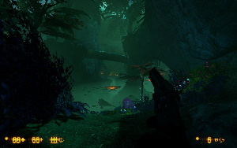
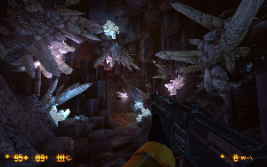
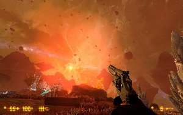
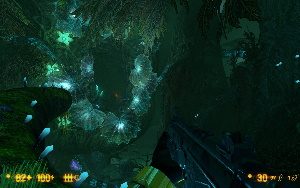

https://youtu.be/YkBrNGeFwoU

They’ve given the legendary, but now pretty creaky, Half-Life a careful makeover and thrown in a bunch of new ideas. It turned out great; you can really see the fans put their hearts into it :-) Xen benefited especially, although I think the factory could have been shorter. Still, the reworked Nihilanth fight more than makes up for all the suffering.

There are minor issues with music, optimization, and translation, but nothing particularly serious. Given how long it was in development, it’s amazing they got it out at all. Long projects tend to wear people out and burn them out, and that’s before you even get to the enormous job of bringing a twenty-year-old game up to date! Quite a nasty piece of work you managed over there, guys. I am impressed.

   
