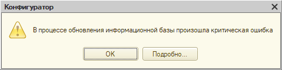
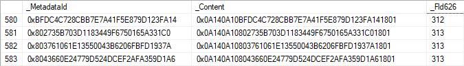

So, Designer reports an error, and we need to fix it or find a workaround. This could get awkward: we can’t look at the application’s code. Still, to fix it, we need to work out what Designer was doing before it fell over, and why it couldn’t finish.

What can help?

First, the error message itself. Often, that alone is enough to get your thoughts moving in the right direction. If a query caused the failure, the error will also include a message from the DBMS.

Second, the technological log, capturing EXCP, SDBL, and DBMSSQL (DBPOSTGRS?) events for t:applicationName=Designer. That shows us the exceptions inside Designer and the queries it runs, which are often what went wrong.

A database query trace can also help. With MS SQL, you can capture it using Extended Events; specifically, we’re interested in error_reported, rpc_completed, and sql_batch_completed. The principle is the same: capture query execution errors and the queries themselves.

Here’s an example. Maybe not the best one, but it’s fresh.

We’re working with a configuration that uses [data separation](https://v8.1c.ru/platforma/razdelenie-dannyh/). Its database is divided into pieces, or data areas, each of which knows nothing about its neighbors: how many there are, their sizes, and so forth. The database also contains shared data, such as catalogs accessible from any area. These usually hold technical information, for example a list of metadata objects.

We need to take the FileStorageVolumes catalog out of the main separator. The catalog is currently separated, meaning its data differs from one area to another. We need its contents to become the same across all areas.

This should be straightforward, since the catalog table is empty: no area stores anything in it. We apply the [setting](setup.png), and:

The exception [text](error.txt) contains two messages: one from the platform, the other from the DBMS. The first one makes me scratch my head: what does it mean, the data isn’t unique? The catalog is empty; there’s no data. Maybe something’s wrong with one of the supporting structures, rather than the catalog data itself.

The DBMS message is clearer: MS SQL Server tried to create a unique index on _DataHistorySettingsNG, but couldn’t because combinations of indexed fields weren’t unique. It even gives the specific value that prevented index creation: NULL.

Conclusions?

1. The problem clearly arose during restructuring. First, that’s exactly what we were doing. Second, both CREATE UNIQUE INDEX, since creating indexes is part of restructuring, and the problematic table’s name point to it. The NG suffix is assigned to table copies created during restructuring. If restructuring succeeds, the platform drops the original table and renames the copy.
2. The problem involves the data history mechanism’s settings, _DataHistorySettings. This table stores each metadata object’s status: whether to maintain data history for the object, its fields, and its tabular section fields, if any.

That explains how an empty catalog can have a uniqueness problem: an object’s data history settings exist independently of whether the object contains data. The settings table has just three fields: _MetadataId (the metadata object’s ID), _Content (setting values), and _Fld626 (the area separator).

Before restructuring, the data looks roughly like this:

But then the picture changed. When we excluded the catalog from the common attribute, Designer started restructuring: it created _DataHistorySettingsNG, copied the data from _DataHistorySettings, and set _Fld626 to NULL for all records belonging to FileStorageVolumes.

The result? A whole pile of settings for FileStorageVolumes that belong to no data area. That sounds unhealthy in itself, but the real trouble started when Designer tried to create the table’s clustered index. It is [built](index.png) on _MetadataId and _Fld626 and is unique, so it cannot be created: many records differ only in _Content, while _MetadataId and _Fld626 are guaranteed to be identical.

Just to be sure, let’s check the [technological log](20103116.log). I’ve stripped out the unrelated events and other clutter. Sure enough: Designer creates and populates _DataHistorySettingsNG, tries to index it, receives an error, and drops it. The DBMS [trace](20103116.png) shows roughly the same picture.

That’s where the interesting part ends, since the solution is fairly obvious: delete the catalog’s data history settings in every data area and repeat restructuring. This doesn’t fix the bug, of course. Really, Designer should catch this and give us a sensible error message, as it does when deleting an information register dimension would violate the uniqueness of its records. But it does get the task done.

And we’re done. Look at us go!
