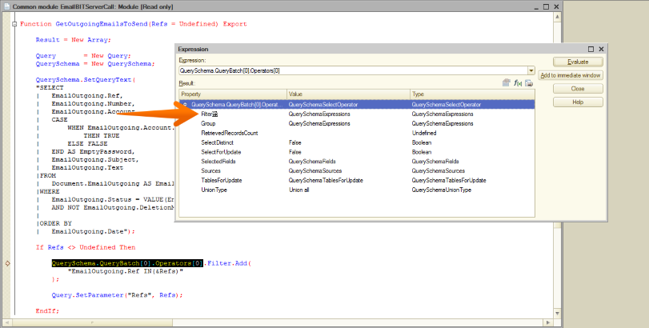

I’ve been writing for the 1C platform for quite a while and have seen some shit, but honestly, this is a first.

At first, I didn’t even know where to begin. I looked up a translation of the character: Wikipedia just told me it was a [type of cup](https://en.wiktionary.org/wiki/%E4%80%80), while Google Translate [gave up entirely](https://translate.google.com/#view=home&op=translate&sl=auto&tl=ru&text=%E4%80%80).

A colleague said it looked a bit like a warehouse worker moving stuff between boxes. I’m not so sure. To me, it looks more like a drummer at work. But what the hell does it mean? Is 1C trying to tell me something? Something about music?

Maybe I should have become a bass player instead of doing all this.
