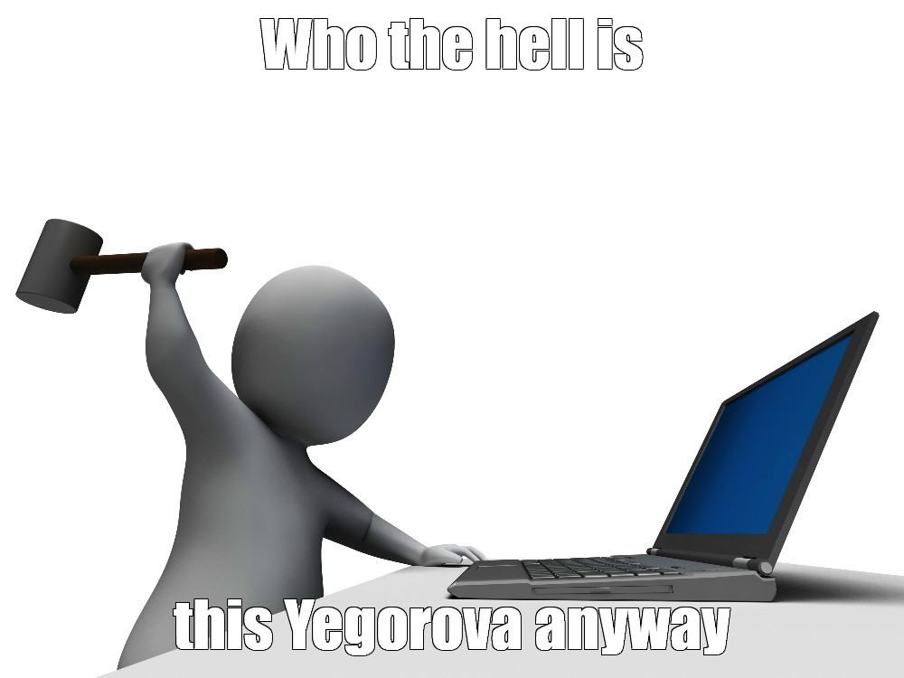

I've been using Whisper pretty much nonstop for meeting transcription over the past six months, and I've noticed a funny effect: the bigger the model, the better it is at recognizing actual speech — and the more confidently it makes shit up when there is no speech at all.

For example, this often happens at the beginning of a webinar or a meeting while people are still joining. It's quiet, nobody is talking, maybe someone is loudly sipping coffee. And then Whisper suddenly starts spitting out something like this:

> Subtitle editor A. Sinetskaya, proofreader A. Yegorova  
> Subtitle editor A. Sinetskaya, proofreader A. Yegorova  
> Subtitle editor A. Sinetskaya, proofreader A. Yegorova  
> Subtitle editor A. Sinetskaya, proofreader A. Yegorova  

And worse, **it sometimes keeps doing this even after perfectly intelligible speech has started**.

This got annoying enough that I finally went down the rabbit hole.

## Why does it transcribe silence like that?

Whisper isn't just a sound-to-text recognizer. Under the hood, there's a pretty powerful language model trying to predict the most likely text based on both the audio and the context it has already transcribed. Most of the time, that's exactly what you want: it handles speech, context, names, and complicated phrases remarkably well.

But if the input is silence, noise, or some unintelligible mumbling, the audio stops being very useful. And that's where the model starts guessing: okay, what kind of text could plausibly go here? It was trained on a gigantic dataset of audio with text transcripts scraped together by OpenAI from all over the internet — around 700,000 hours, if I remember correctly.

And I assume plenty of that stuff came from videos with subtitles — and subtitles are messy as hell. During a silent bit, the subtitle track might happily contain the translator's name, an editor credit, a studio name, "thanks for watching", or some other garbage that isn't present in the audio at all.

And that, I suspect, is how Sinetskaya and Yegorova entered the history books. I couldn't figure out what exactly they worked on, but apparently some subtitle credit mentioning them occurred often enough in the training data for Whisper to eventually decide that silence and Yegorova are, statistically speaking, basically the same thing.

## Why doesn't this happen only during silence?

Yeah, if it merely produced garbage during pauses, this wouldn't really be a problem. The garbage phrase is known, so you could just filter it out. The nasty part is that a bad transcription poisons the model's context. Oversimplifying a bit: Whisper hears silence, decides it's Yegorova, then feeds “Yegorova” back into itself as context for the next chunk and carries on from there.

The next chunk might also become Yegorova. And the next one. And the next... By the time the speaker finally starts talking, they'd better enunciate REALLY clearly if they want to convince the model that yes, this is in fact human speech and not Yegorova, who has now accumulated twenty chunks' worth of momentum. As a result, Whisper can get stuck in this state for a surprisingly long time.

The problem is ancient history by ML standards — okay, fine, about four years — and it exists in a bunch of languages. Russian, incidentally, [has its own special flavor](https://github.com/openai/whisper/discussions/928#discussioncomment-5372187): while some poor Italian might be haunted by a boring “Subtitles created by the Amara.org community,” we, shall we say, have our own fandom.

## How do you deal with it?

The usual advice is to tune inference: reset context after long pauses, fiddle with `no_speech_threshold` and `condition_on_previous_text`, strip silence beforehand using VAD, and so on. I never got around to trying VAD, but I did experiment with the other options, and yes — you can get perfectly decent results for a particular troublesome video.

The problem is that this doesn't really work for my use case. I need to transcribe all kinds of stuff: meeting recordings, lectures, phone calls, whatever. A combination of tricks carefully tuned for one video tends to fall apart on another. Out of pure engineering stubbornness, I even tried building a wrapper along the lines of: "run the video through three different inference setups, analyze all three outputs, then pick whichever one has the lowest Yegorova concentration". It still worked kinda meh.

So I eventually went with a different solution: **use a dumber model!**

Seriously. It works. At least on my recordings, Whisper Small falls into repetition loops on silence much less often. My guess is that the weaker model simply has a harder time confidently hallucinating a garbage pattern, so when it hears silence, it just outputs nothing.

Oversimplifying again:

- Whisper Small: Uh... I can't hear anything. No idea.
- Whisper Medium: Uh... I can't hear anything... *(strains all its parameters)* OH! I KNOW! *(fanfare starts playing)* THAT'S YEGOROVA!

:D

Suffering from success. Literally.

The transcription quality with Whisper Small is obviously a bit worse — more mangled words, less coherent phrasing — but <s>that's still better than Sinetskaya eating a third of the recording and Yegorova devouring the rest</s> overall, the result is much more predictable.

Besides, I'm going to throw the transcript into something like ChatGPT afterwards anyway to generate a summary, and for that absolute gigachad, reconstructing the conversation context is barely an inconvenience even if a few chunks of dialogue got mangled or dropped.