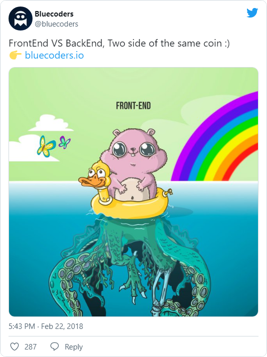

When people talk about how something develops, a product, a language, a programming language, whatever, they sometimes call it “evolution.” The idea is that bad solutions gradually die out, while good ones stick around and make the thing better. Fair enough, but that’s not the part I’m thinking of right now. The catch is that descendants inherit more than the useful stuff. They also get every badly put-together, often pointless mechanism that didn’t quite manage to kill their ancestors.

As a result, we hold our breath while swallowing, get confused between dissatisfied and unsatisfactory, and program in the wonderful language JavaScript, which, handy and popular as it is, has picked up every flaw a scripting language could possibly have, and then some.

We’re still lucky, though: consider giraffes! Their laryngeal nerve first travels two meters down the neck and then back up to the laryngeal muscles, instead of going the few centimeters straight from the brain.

Knowing all this makes it a little easier to look at what my code sometimes turns into after another round of development. So what if this hamster has grown a dragon’s tail? Evolutionarily speaking, that’s a pretty useful tail. Who am I to argue with Darwin?

