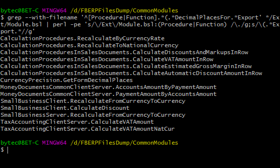

The task: find methods in a configuration’s common modules that have a specific parameter, DecimalPlacesFor in this example.

A normal search through the configuration code produces many false positives, such as every reference to a parameter with that name inside method bodies. The platform doesn’t support regular expression searches yet, so the easy way is to export the configuration to files and run a Bash [script](https://github.com/vkostyanetsky/ScriptsForLogAnalysis/blob/master/Файлы%20конфигурации/MethodsWithParameter.sh) on the common modules directory.

The bit before the pipe does the searching. The rest trims the output down to module names and the methods found in them. For example:

Profit? Profit!
