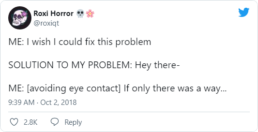

One thing that makes learning English much easier is practice that practically falls into your lap. Sometimes it’s more useful than examples from something like the Cambridge Dictionary, simply because it sticks better.

Yesterday in class, for example, we were working on hypothetical situations and getting our heads around wish and if only. Today, the first thing in my feed was this tweet. Hard to make it any clearer :-)

Or take the difference between try and trying, which we recently reviewed. I memorized it long ago thanks to Felicity’s strained “I do my best” in Borderlands: The Pre-Sequel. That scene sticks with you, and so does the sense that she just can’t do what’s being asked of her.
