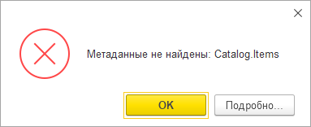

I doubt many people have run into this one. First, you need to use the platform’s built-in data history, which isn’t especially popular. Some people are tied to the Standard Subsystems Library, which still uses familiar versioning through information registers; others don’t like how it’s implemented, and to be fair, the performance does have some rough edges.

Second, you need to disable data history for a metadata object and delete its accumulated object versions **before** new changes move from the buffer into the main table.

Here’s how data history works. It’s off by default. If you have the right permissions, you can turn it on for the objects you need: constants, catalogs, documents, and so on. The platform then records exactly what changes in those objects. It does this in two stages: first, a relatively fast write to an intermediate buffer, _DataHistoryQueue0; then, when UpdateHistory() is called, the data moves to the main version table, _DataHistoryVersions, and shows up in the app.

History can be updated immediately on writing, but to shorten the transaction, that step is usually moved into a scheduled job. So the data moves out of the buffer every so often, say once every five minutes. If, between an object’s data change and the history update, you disable its history and delete its versions, UpdateHistory() throws an exception: it tries to move changes from the buffer to the main table, but can’t match them up with the data already there.

Here’s some [code](https://gist.github.com/vkostyanetsky/ca766fe281425953e0e2bbfe12fc70e2) that reproduces the problem with the Items catalog on platform 8.3.17.1989. Swap in any other object that supports data history; the result is the same.

**How do you avoid the error?** Obviously, call UpdateHistory() immediately before disabling history for the object. Ideally, do this when users aren’t working in the system: someone’s transaction could slip in between updating and disabling history and cause the same problem. Exclusive mode can guarantee that won’t happen.

An exclusive lock on the object’s table also comes to mind, but the documentation advises against calling UpdateHistory() inside transactions, so I’m not sure about that.

**How do you fix the error?** Enable data history for the affected object, update history, and disable it again. Back out, then try again properly, so to speak.
