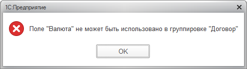

The Data Composition System goes by the rule “if the user can’t view it, it might as well not exist.” Sometimes that leads to some pretty weird behavior. For a nice simple textbook report, it works fine: if the user lacks view rights for a catalog, for example, that catalog won’t appear in the report. Real examples can be more complicated, though.

A couple of weeks ago, I was debugging a report that produced a seemingly clear error when generated:

The report is enormous: a query of a good thousand lines, complex settings, a huge template, and tangled composition code. We first suspected a settings error, but the investigation quickly led from a currency reference in the dataset to a constant holding that currency at the report’s lowest level. The user had no view rights for that constant.

I couldn’t tell you exactly what threw the platform off and made the error so unhelpful. Maybe it was what we did with the temporary table holding the constant. Maybe it was reading it inside a CASE expression. Or maybe it was that we had all the rights we needed for the currency catalog itself. I didn’t dig around to find the exact trigger. I think it’s simply an implementation detail of the DCS engine that may change between versions. Just keep view rights in mind, and you can avoid the problem.

If you encounter the error, try generating the problematic report with full rights. If that works, list the tables from which it reads data and check that both read and view rights are granted for all of them.

Tedious, but it can save a lot of time.
