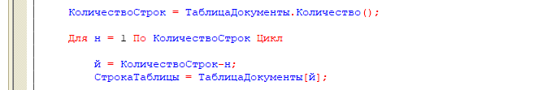

Hello, everyone! Johnny Catswill is back with another episode of Self-Documenting Code!

Today, we’ll iterate over value table rows from Н to Й:

It seems like a tiny thing, but by the fifth time you run into this kind of variable naming in the same module, your eye starts twitching :-)

It isn’t even that this section is [harder to understand](/notes/why-so-serious); it says a lot about the module’s overall quality. The programmer who wrote it was probably exhausted, and somewhere nearby you’ll likely find something like someone cheerfully dumping the entire product catalog into a value table, reading a bunch of objects “through a dot,” and more of the same slapdash stuff.
