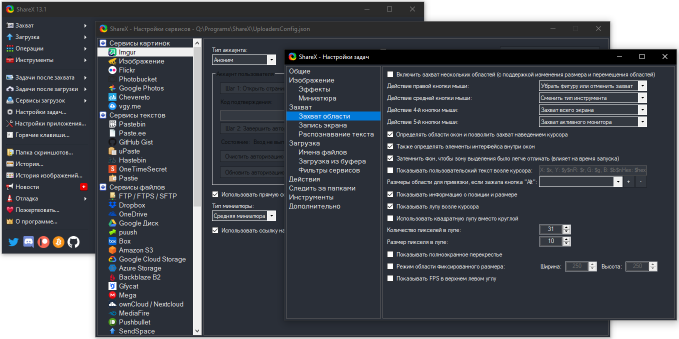

Before switching to OBS Studio for video recording, which I wrote about in my [previous note](/notes/video-recording), I tried [ShareX](https://getsharex.com/). It worked well at first, but one nasty bug made me give up on it. Sometimes I’d stop recording and end up with a broken video.

I googled around but never figured out why. That isn’t surprising: ShareX uses [ffmpeg](https://www.ffmpeg.org/) to record video, and this child of open source calmly dumps a whole scroll of logs instead of useful diagnostics. Trying to make sense of that without knowing your way around it is a job for an incurable optimist.

As a screenshot tool, though, ShareX is almost flawless. All those options remind me a bit of an exhausted person having a sudden burst of hyperactivity :-)

> “I’ll test it myself! I’ll test everything myself! And mop the floors!”

> *[Efficiency Doesn’t Work. Ilya Yakyamtsev](https://www.youtube.com/watch?v=K6oZuB8_dU8&feature=youtu.be&t=640)*
