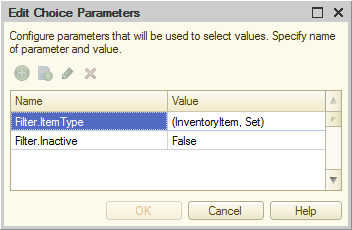

A couple of weeks ago, we added an “Inactive” parameter to FirstBIT ERP’s product catalog. The task was simple: if a user no longer needs a product, they check the box and it disappears from everywhere, including selection forms and warehouse balance selection forms.

Sounds straightforward, right? The code was simple too: we went through every object where users select products and added an extra choice parameter.

But users started complaining that the setting didn’t work. We investigated and realized we’d forgotten input history. Turns out it just ignores choice parameters. Users selected a product in an invoice, marked it inactive, returned to the invoice, and… Saw the supposedly disabled product in the history again.

We looked for a way out. The problem is that input history lives in system storage, and there’s no way to change it from code. You can wipe it altogether, but it only actually clears when the client restarts, and even then it’s hit and miss. Disable history completely? That feels like curing a cold by cutting off the patient’s head.

At some point, we learned that input history is stored not just per field, but also per combination of choice parameters. Each combination of parameters and values has its own history. So, if we add another choice parameter to every product selection field, changing its value will “clear” the history. In reality, it creates a new one, but what difference does that make to the user?

So that’s what we did. It lives in shared storage and is passed to forms when they open through a common module that adds the choice parameter programmatically. When a user sets or clears Inactive for any product, the parameter changes, and already open forms receive it through notifications.

It all started so innocently, didn’t it?

It works pretty well, but the downsides are obvious. First, system storage gradually grows as new combinations of real choice parameters and our artificial one appear. Second, saving products is now a potential bottleneck: two users can’t save products with changed Inactive flags at the same time, because writing our hidden choice parameter’s new value to shared storage causes a lock.

The first problem can be solved by clearing storage on some trigger; the second, by storing our choice parameter per user, for example in an information register. Still, we’re really hoping 1C gives us access to input history before we have to pile more workarounds on top of the ones we’ve already built :-)
