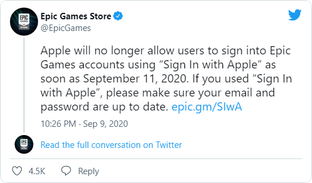

Whatever else you make of <s>this clash of two yokozuna</s> the Apple–Epic Games fight, it’s a great reminder that you shouldn’t use Single Sign-On on the internet: anywhere, ever, on any service. Who knows which giants will suddenly come to blows next, or which website will ban you for no clear reason? Because screw you, dude, that’s why.

The users in that tweet might get off lightly. But if, say, Google blocks your account, you could be in real trouble: a pile of services you accessed through Google will suddenly turn into pumpkins.

There are plenty of solutions just as convenient as Single Sign-On. Password managers, browser extensions, hardware keys: almost anything is better than proprietary, closed-source services you have no say in.
