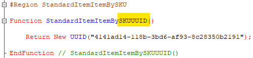

A couple of weeks ago, Alexander Kuntashov [posted](https://t.me/kuntashov_devnotes/479) an amusing screenshot on his channel of an enumeration from the Electronic Documents Library. Whoever wrote it really had a thing for long abbreviations. I had a great time joking about the family resemblance between ИППДОИПУПДУКД and Moscow’s ГНУВНИВИПФИТ, then spotted this beauty in my own code:

Not quite the master’s touch yet, of course, but definitely heading in the same direction. It reminded me of the parable about the speck in someone else’s eye and the great big log in your own :-)
