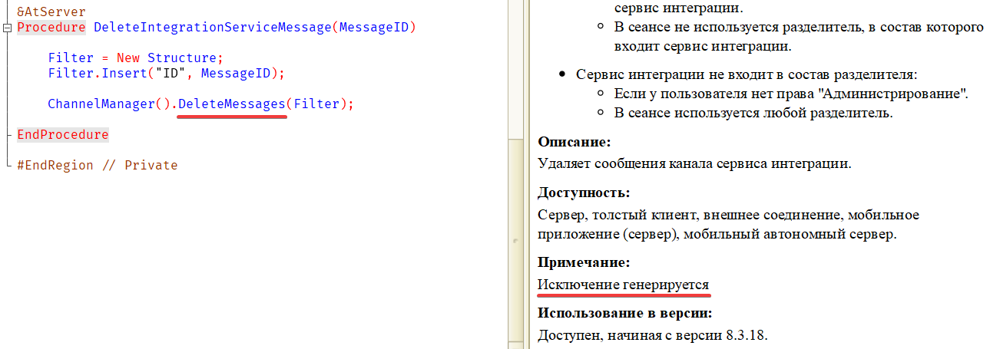

A little existential despair from the Syntax Assistant, in case you were somehow short of it:

This is the help for the integration service channel manager’s DeleteMessages() method. Seriously, I get what they meant: all integration service methods throw exceptions if called in a session with data separators enabled. The documentation carefully mentions this for every method, so apparently part of the sentence went missing here. The English documentation for this method, for example, is fine.

It still looks funny. Reminded me of an old meme:

