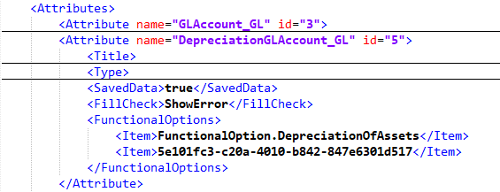
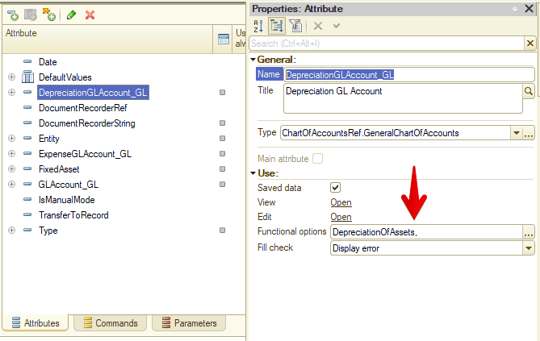
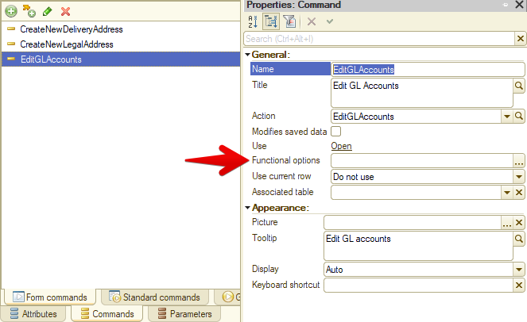

Here’s one way to solve [unresolved references](/notes/unresolved-references) left after deleting a functional option. It starts with a configuration check giving me a couple of dozen messages like this:

    CommonForm.PersonalSettings.Form Unresolved metadata object references (2)
    Catalog.BankAccounts.Form.GLAccountsEditForm.Form Unresolved metadata object references (1)
    Catalog.CashRegisters.Form.GLAccountsEditForm.Form Unresolved metadata object references (1)

I export the configuration to files and open Form.xml for one of the affected forms. I pick a form with fewer controls, so there’s less stuff to sift through.

A quick scan for anything unusual doesn’t take long:

A normal functional option reference is its name, as with DepreciationOfAssets. If there’s a GUID instead, that functional option is missing from the configuration. The reference is unresolved.

I search the rest of the export for that GUID, and there are almost all the problems the platform complained about. Fixing them is easy: remove the broken reference from the XML and load the file back into the configuration. There’s an even simpler approach: open the form control’s functional options list and immediately save it. That also removes the broken reference.

Why is looking for these strays in Designer itself a job for incurable optimists? Because the problem is almost impossible to notice. At best, you’ll see something like this:

Designer knows there are two options in the field, but can’t get a name for the second one. It’s gone. And most often there’s only one functional option! Then it looks like this:

https://www.youtube.com/watch?v=EHX7NZS8zAI
