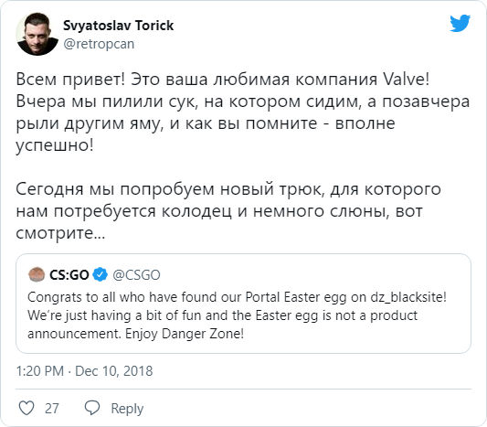

The folks at Valve keep teasing fans of their games, whether out of habit or because someone there really thinks it’s a great way to stay in people’s minds.

Sure, we all know where things stand with Valve making games. Few people seriously expect Half-Life 3 or, say, a Portal sequel. Still, I can’t help smiling at the effortless grace of Valve dealing with its fans. Like a bull in a china shop.

