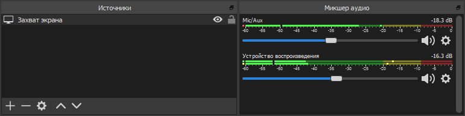

I work remotely, so I talk to colleagues over Zoom and Slack. Mostly in chats, but many subjects are still easier to discuss by voice. That’s where it gets awkward: forget message indexing and search, and, most importantly, there’s no conversation archive. Sometimes you really need to remember: who said it? What exactly? When?

Zoom and Slack don’t solve this on their own. Zoom only records meetings you organize or have permission to record, which is far from all of them, while Slack doesn’t record video at all.

## Solving the Problem

I solved it some time ago by installing [OBS Studio](https://obsproject.com), screen recording software popular with streamers. It handles conference recording beautifully. Setup is minimal: record the entire screen, microphone audio, and all playback audio. After a few test recordings, you can add mixer filters such as gain and noise suppression.

Choose where to save the recordings under Output → Recording → Recording Path. We’re recording calls, so there’ll be lots of files. Might as well sort them into folders by day from the start. Go to Advanced settings and set Filename Formatting to something like %CCYY-%MM-%DD/%hh-%mm-%ss.

## Quick Recording Controls

Opening OBS for every call is inconvenient, but it supports plenty of hotkeys. You can press some elaborate combination at the start and end of a conversation. That didn’t work for me, though: for some reason, the shortcuts kept slipping my mind. Even sticky notes didn’t help.

At first I got quite annoyed, then realized: if I can’t remember a shortcut, I should get rid of it. Start recording with one button, stop with another.

The hardware was easy: I have an ergonomic Microsoft [keyboard](https://www.microsoft.com/accessories/ru-ru/products/keyboards/natural-ergonomic-keyboard-4000/b2m-00020) with a wagonload of programmable buttons. Software was harder: OBS Studio understands some launch [parameters](https://github.com/obsproject/obs-studio/wiki/Launch-Parameters), but there’s not much to choose from. There isn’t even a stop-recording option. I wanted more.

I eventually solved it with an OBS Studio plugin that lets you control a running instance. It was designed for remote recording control, from a smartphone for example, but it works just as well on the same machine.

Here’s what I ended up with:

1. Install OBS Studio and the [obs-websocket](https://obsproject.com/forum/resources/obs-websocket-remote-control-of-obs-studio-made-easy.466/) plugin. Clear “Enable System Tray Alerts” under Tools → WebSockets Server Settings, or it will report every little thing.
2. Put this [utility](https://obsproject.com/forum/resources/command-line-tool-for-obs-websocket-plugin-windows.615/) somewhere convenient to control the plugin from the command line.
3. Assign OBSCommand.exe /startrecording to one button and OBSCommand.exe /stoprecording to another.
4. Done. Look at you go!

A console window pops up for a moment when you press the button: OBSCommand launches, contacts obs-websocket, and waits for a reply. I initially wanted to hide the window, but changed my mind. If OBS Studio isn’t running or something goes wrong, the console will stay open, and at least I’ll know recording hasn’t started.
