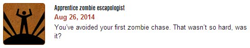

Like most fat guys, I’m not big on running, and just forcing myself doesn’t work. I get two or three days out of sheer willpower, then I’m back to being lazy and dreading the next run.

So I had to find something that would actually make me want to run. Eventually, I came across the phone game [Zombies, Run!](https://zombiesrungame.com/). Basically, it’s a music player: load a playlist and go for a walk. But familiar tracks alternate with a simple story about surviving in a typical zombie land. Your helicopter has crashed, and you’re trying to reach other survivors. You search for supplies and medicine… And zombies surround you, so if you want to live, move your ass.

Je-e-esus Christ! It’s fantastic. I don’t know whether the game or my imagination deserves the credit, but hundreds of thousands of kills in Left 4 Dead didn’t help me at all: growling behind your back makes running incredibly easy! The game calmly tells you how far away each undead pursuer is. When one of them suddenly gained forty meters on me, I probably ran the best sprint of my life.

(Toward the end of the second walk, Runner Five also hurt his leg and started limping very convincingly. Really added to the drama and made the whole thing feel real.)
